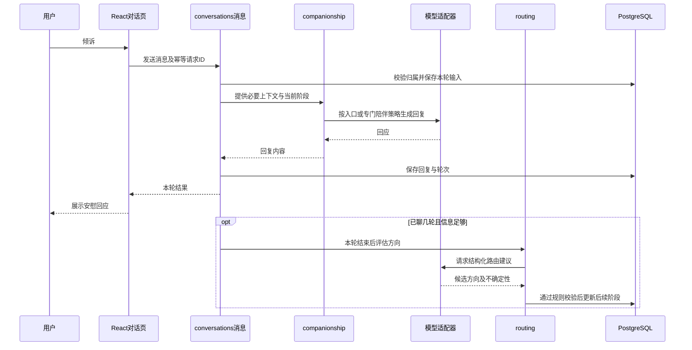

# 安慰网站仓库架构与开发路线

> 2026-10-29 实施更新：应用按用户要求统一位于 `comfort-space/`，本机 Scala 后端及 PostgreSQL 已接通。以下为早期路线，目录示意需加该前缀；当前实现与待办以 [架构与实现边界](../comfort-space/docs/架构与实现边界.md) 和 [后端验收记录](../comfort-space/docs/后端验收记录.md) 为准。真实模型尚未接入；使用流程视频和提交源码包已另行生成，见 [提交材料](../comfort-space/submission/README.md)。

## 1. 当前产品决定

网站核心是让用户先感到被理解，愿意继续表达，而不是一进入就接受分类或问卷。

已确认流程：**用户倾诉 → 入口 AI 陪聊几轮 → 后台判断问题方向 → 专门方向继续安慰**。前台保持同一段对话，不要求用户重述经历，也不弹出分类选择打断倾诉。

- 首轮先回应具体情绪，不急着分析和提建议。
- 不连续追问，不强制每条回复都以问题结束。
- 分类只服务于更贴合的陪伴，不作为诊断或对人的固定标签。
- 用户可以换话题、拒绝建议或随时结束，不以拖长对话作为产品目标。
- “3—5 轮”是先前讨论的试验参考，不是用户确认的固定阈值。轮数按一条用户消息及其对应的一条 AI 回复计算，实际门槛可配置，分类还要看信息是否足够。

本次确定的是代码仓库结构与模块职责，不涉及 GitHub 网站界面设计，不开始付费模型调用或部署。

## 2. 仓库与技术基线

继续使用现有仓库 `Casio113343/-20261022`，前后端在同一个 Git 仓库管理。

| 部分 | 技术与职责 |
| --- | --- |
| frontend | TypeScript、React、Vite、React Router、Tailwind；跨页核心状态按需使用 Zustand |
| backend | Scala 3、Cats Effect IO、http4s、Circe；领域模块与消息式 API |
| 数据库 | PostgreSQL，保存账号、会话、消息与必要路由状态 |
| AI 访问 | 后端统一调用模型；提供方、模型、预算与数据处理配置尚未选择 |
| 文档 | docs，保存当前需求、架构、接口与验收说明 |
| 参考资料 | course-source，仅供学习，不混入应用运行入口或提交附件 |

沿用教学系统的业务闭环、LOCUS 的模块化单体与可追踪接口；具体执行课程 60 条规范和根目录规章。多个陪伴方向优先通过同一模型配不同策略实现，不先部署多个独立 AI 服务。

## 3. 目标目录结构

以下是计划结构，按开发阶段逐步建立，不用空文件假装工程已完成。

```text
/
├─ frontend/
│  ├─ package.json
│  └─ src/
│     ├─ pages/
│     │  ├─ HomePage/
│     │  ├─ ConversationPage/
│     │  │  ├─ index.tsx
│     │  │  ├─ components/
│     │  │  ├─ hooks/
│     │  │  ├─ functions/
│     │  │  └─ objects/
│     │  ├─ ConversationsPage/
│     │  └─ ...其他已确认页面
│     ├─ components/ui/
│     ├─ apis/identity/
│     ├─ apis/conversations/
│     ├─ objects/identity/
│     ├─ objects/conversations/
│     ├─ stores/                 仅跨页共享状态
│     ├─ system/api/             发送、错误、稳定路由名称
│     └─ router.tsx
├─ backend/
│  ├─ build.sbt
│  └─ src/
│     ├─ main/scala/services/
│     │  ├─ identity/
│     │  ├─ conversations/
│     │  ├─ companionship/
│     │  ├─ routing/
│     │  └─ system/
│     └─ test/scala/
├─ docs/
├─ course-source/
├─ AGENTS.md
├─ 本项目编码规章制度.md
├─ .gitignore
└─ README.md
```

每个业务服务按需包含 `api/`、`objects/`、`routes/`、`tables/`、`utils/`。表单独放 `tables/XxxTable/`，区分表方法与初始化文件。单个类型、消息分别独立文件。

共享模型客户端与基础设施归属 `services/system/`，其中 `model/` 用于外部模型协议、超时及错误适配，`database/` 用于连接和事务，`api/` 用于统一消息路由；这些额外目录有真实基础设施职责，不作为新的业务层。

## 4. 后端模块职责

| 模块 | 负责什么 | 公开能力示例 |
| --- | --- | --- |
| identity | 账号、会话、可信身份、用户偏好 | 校验会话、读取本人资料 |
| conversations | 对话归属、消息顺序、保存、重试和删除 | 创建会话、发送消息、读本人历史 |
| companionship | 入口陪伴策略、专门方向策略、上下文组织、回复生成 | 根据当前阶段和必要上下文生成回应 |
| routing | 何时允许分类、方向判断、置信度与路由更新规则 | 在已有足够对话时提出路由建议 |
| system | 模型适配、配置、资源、事务、路由与通用错误 | 统一模型调用接口和基础机制 |

不让 routing 决定首轮是否可以安慰。分类服务不可用时，仍由入口陪伴策略继续聊天。

专门方向先作为可配置策略集合：学业与工作、人际关系、自我评价、孤独与低落、失去与变化。分类名称、数量和提示词尚待细化；允许多个候选和“暂不确定”，用户原话比旧分类更重要。

## 5. 一条消息的数据流



分类不是用户回复的前置阻塞条件。图中后续评估必须由服务器实际管理的流程执行并处理失败，不能依赖已经结束的请求里无人管理的后台任务。首版可先提供独立、幂等的内部评估操作，具体调度方式在实现时明确；不能在文档阶段声称已具备后台任务机制。

数据库事务保持短暂：保存输入、模型调用、保存输出分为明确阶段，不持有数据库连接等待模型。虽然 API 统一采用 `plan(connection): IO[Response]`，模型编排要由 system 的请求执行机制分阶段调用，不能直接把外部网络耗时包进长事务。具体执行器是下一步设计与验证项目。

## 6. 对话阶段与切换规则

| 阶段 | 用户看到的体验 | 后端行为 |
| --- | --- | --- |
| Settling | 先被听见，自然聊几轮 | 使用入口策略，不要求类别或过多信息 |
| GeneralSupport | 信息还不够，继续自然陪伴 | 暂不采用不确定分类，稍后再评估 |
| FocusedSupport | 回应逐渐更贴合具体处境 | 使用专门策略，带入必要上下文 |

分类评估另有 pending、succeeded、failed 状态，不作为一个要向用户展示“正在分类”的聊天步骤。

- 先完成前几轮陪聊，再评估是否进入某个方向，不按第一次关键词立即分流。
- 未达可信条件则维持通用陪伴，不为了完成流程硬选一类。
- 更新路由时带入原话中的关键事实和必要摘要，区分事实与推测，不把摘要当成完整记忆。
- 新话题出现后允许调整，但不逐条消息来回切换；策略版本和路由版本可追踪。
- 返回消息保持同一对话身份和语气，不冒充新的人类或真人专家接管。
- 若出现明确的即时危险信号，及时给出适当支持，不为了凑轮数延迟回应；具体风险应对另行设计与验证。

## 7. 数据模型草案

| 对象 / 表 | 关键内容 | 归属 |
| --- | --- | --- |
| User、Session | 用户ID、认证与会话 | identity |
| Conversation | 所有者、阶段、当前策略、版本 | conversations |
| Message | 会话ID、角色、正文、顺序、生成状态 | conversations |
| ReplyRequest | 客户端请求ID、状态、关联输入和回复 | conversations |
| RoutingDecision | 候选方向、置信度、输入版本、策略版本 | routing |
| ConversationContext | 必要摘要、适用消息范围与版本 | conversations |

初版陪伴策略保存在受版本控制的配置中，未必需要额外数据库表。阈值可配置，不将具体模型版本、预算和提示词散落在页面里。

失败与并发规则：同一请求ID不重复保存消息；同一会话的生成操作明确顺序；超时保留用户输入并允许重试；旧版本分类结果不能覆盖新话题；只成功保存的完整回复进入正式消息历史。流式输出、取消与断线恢复在加入时单独明确，不先假装支持。

## 8. 最小接口契约

| 消息 | 输入要点 | 结果要点 |
| --- | --- | --- |
| CreateConversationMessage | 可信用户或受控访客身份 | 会话ID |
| SendMessageMessage | 会话ID、正文、幂等请求ID；内部可信身份 | 回复及发送状态 |
| ListConversationsMessage | 本人身份、分页条件 | 本人会话列表 |
| GetConversationMessage | 本人身份、会话ID、消息分页 | 可恢复的历史 |
| DeleteConversationMessage | 本人身份、会话ID | 删除结果 |
| AssessRoutingMessage | 会话ID、消息版本；仅后端内部 | 路由建议或维持通用陪伴 |

前端不传“我属于某一类”来决定后端信任规则，也不直接持有模型密钥。实际 Request / Response 类型、认证方式与错误码在接口文档中细化。

## 9. 页面范围与隐私

先开发首页入口、聊天页和历史列表，暂不为凑约 10 页拆出五个类别聊天页面。其余候选为历史详情、收藏、收藏详情、安静休息、个人偏好、账号入口及数据管理，最终页面清单仍需结合功能确认，不能将这些候选当成全部已批准范围。

私有会话和分类结果不公开，客户端显示自己的会话也必须经过后端所有权检查。访客是否落库、保存多久以及转账号方式需明确；用户开始真实对话前应知道保存及模型提供方的数据处理方式。

GitHub 保存代码、提示词版本、配置模板和合成测试数据。**不保存真实倾诉、账号凭据、模型密钥、生产数据库导出或带正文的日志。** 分类摘要也属于私有对话资料。默认不添加给管理员浏览全体倾诉的后台。

## 10. 按顺序推进的工作

1. **当前：架构记录。** 固化用户体验原则、目录、模块和数据流，清理旧设计冲突。
2. **下一步：最小接口与数据设计。** 定义会话、消息、阶段、错误、幂等与模型执行边界，确认模型接入和预算后才调用真实服务。
3. **工程骨架。** 建立 frontend/backend、配置模板、数据库初始化及检查命令，依赖版本核对后锁定。
4. **第一条纵向流程。** 输入一句话 → 后端生成入口回应 → 保存 → 刷新恢复；未接真实模型时明确标识测试替身。
5. **后分类流程。** 前几轮不分流、足够信息再判断、分类失败不打断聊天、切换不丢上下文。
6. **专门陪伴与页面补齐。** 检查不同方向的回应差异，再增加已确认的收藏与个人功能。
7. **验收与交付。** 验证私有访问、重试、上下文、回复质量和实际页面；准备3分钟内录像及100M以内附件。

有意义的测试至少覆盖：早期不分类、信息不足维持通用、分类失败仍回复、重复发送不重复入库、旧分类不能覆盖新状态、他人不能读会话、专门策略切换保留必要事实。对话质量还需人工评审，不能只靠构建成功判断“安慰有效”。

本文件为设计产物，不表示前后端工程、模型或调度器已经实现。
