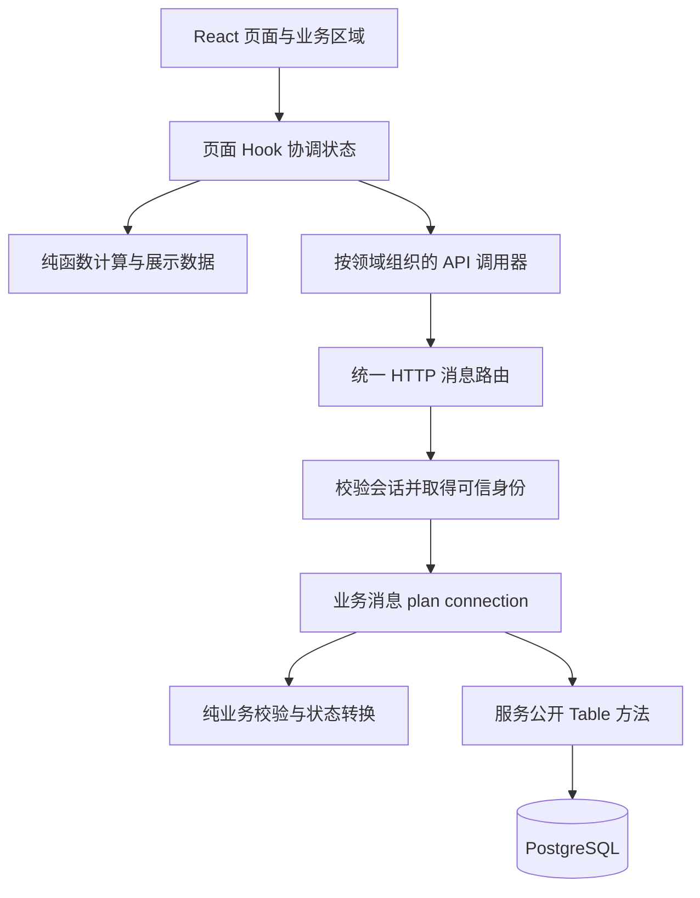

# 项目想法与架构约定

> 当前产品为多类型游戏生成平台，前端需求以 [游戏生成平台前端需求规格](./游戏生成平台前端需求规格.md) 为准。本文定义两个案例的共同工程约束。

## 1. 已确定与待讨论事项

**用户已确定**：本项目架构模仿线上教学系统与 LOCUS 两个案例，并将约定写入 Markdown。

**既有要求**：约 10 个页面，完整前后端，使用录像不超过 3 分钟，提交附件不超过 100M，技术与代码规范遵循根目录《本项目编码规章制度.md》。

**当前产品决定**：用户指定游戏类型与参考玩法，填写创作要求、世界观与人物，审阅补充方案后生成游戏并试玩、修改。

## 2. 架构模仿的具体范围

| 参考对象 | 采用的架构思想 | 在本项目的落实 |
| --- | --- | --- |
| 教学系统 | 角色、领域对象、状态和操作形成业务闭环 | 一条主流程覆盖创建、参与、处理、结果反馈 |
| 教学系统 | 课程工作区组织相关功能 | 围绕一个业务对象集中展示详情、记录和操作 |
| 两个案例 | 页面入口、状态 Hook 和业务组件分离 | 页面目录内组织 index、hooks、functions、objects、components |
| LOCUS | 模块化单体，按领域拥有 API 与表 | 一个后端应用，按 services 划分职责，连接同一 PostgreSQL 实例 |
| 两个案例 | 消息式接口和 IO 计划 | 前端调用可追踪到后端消息、plan、公开 Table 方法 |
| LOCUS | 发布者与使用者共享真实数据 | 一方操作后另一方能查询结果，刷新后数据仍存在 |
| LOCUS | 复杂页面按可见业务区域拆分 | 详情和管理页中清楚呈现摘要、状态、记录和操作区 |
| 两个案例 | 领域状态与接口数据有类型 | Scala 领域类型、枚举与 TypeScript 类型保持契约一致 |

模仿的是责任划分、调用方式和数据流。两套代码的基类、方法签名与目录并不相同，因此不会把两个完整工程拼接成新项目。用户界面风格也尚未定稿，不自动照搬案例的配色与装饰。

## 3. 本项目采用的统一架构

前端：React + TypeScript + Vite + React Router + Tailwind，跨页核心状态按需使用 Zustand。

后端：Scala 3 + Cats Effect IO + http4s + Circe + PostgreSQL，数据库连接采用项目统一资源管理。

上述方案沿用案例与已定规章，具体依赖版本在建立工程时核对并锁定。



公开查询不必强制登录；需要身份的操作才进入身份校验。路由统一执行 IO 计划并编解码结果。数据返回后由 Hook 更新核心状态，派生数据和视图重新计算。

### 3.1 领域模块

| 模块 | 职责 | 范围说明 |
| --- | --- | --- |
| identity | 账号、会话、身份与角色规则 | 不信任前端自报角色或 userId |
| 核心业务模块 | 主题对象、列表、详情与维护 | 选题确定后使用实际名称，如 activities 或 equipment |
| 流程模块 | 报名、预约、借用或反馈等状态变化 | 必须有真实流程；简单时可与核心业务同模块，不强行拆服务 |
| dashboard | 聚合概况、待办与记录 | 实际需要时增加，读真实业务数据 |
| system | 启动、连接、事务、错误和消息路由基础设施 | 不承担具体业务规则 |

先以单进程运行，目录里的 service 表示领域模块，不要求独立网络部署。图片、文件存储、WebSocket 或外部 AI 等能力，仅在主题确需且明确纳入范围后增加。

### 3.2 目录约定

```text
frontend/src/
  pages/<Page>/
    index.tsx
    components/
    hooks/
    functions/
    objects/
  components/ui/
  apis/<service>/
  objects/<service>/
  system/api/
  stores/                 仅放确实跨页共享的核心状态
  router.tsx

backend/src/main/scala/services/
  <service>/
    api/XxxMessage.scala
    objects/
      apiTypes/
    routes/XxxRoutes.scala
    tables/<Table>/
      XxxTable.scala
      XxxTableInitializer.scala
    utils/
  system/

docs/                     需求、页面、接口、模型、测试与交付说明
```

按需要创建目录，保持简单组件扁平。后端每个对象、消息与表模块可独立定位；前端页面专用代码就近放置。

### 3.3 API、身份与事务

- 统一采用本项目消息模型：构造参数表达业务输入，`APIMessage[Response]` 表达结果，`plan(connection: Connection): IO[Response]` 编排业务。
- 不复制教学系统的无参 plan，也不混入 LOCUS 带 Request 泛型和 principal 参数的另一套基类；其事务、身份思想按本项目模型落实。
- 前端通过与消息对应的调用器发送请求；传输层负责统一发送、错误与稳定路由命名。
- 受保护请求在边界解析会话，构造带可信身份的内部消息；权限与对象归属在后端校验。
- 跨模块可调用公开消息和封装的 Table 方法，不访问私有 SQL 或私有 utils。
- 需要原子性的多次写入共享事务连接，明确失败回滚、重复提交和并发条件。
- 使用参数绑定与数据库约束，不把唯一性、容量和状态变化只交给前端控制。

### 3.4 前端状态与页面结构

- 组件声明视图；页面 Hook 协调加载、提交和事件；functions 保存纯计算。
- 核心状态与派生数据分离，不存多份可计算的状态。
- 页面路由守卫负责交互体验，不能替代后端权限校验。
- 表单输入、请求错误、空记录及提交状态应有清楚反馈。
- “10 页左右”按有实际用途的页面规划，不把弹窗、重定向或加载态计为单独页面。

## 4. 产品落实与下一步

当前需求见 [游戏生成平台前端需求规格](./游戏生成平台前端需求规格.md)。游戏生成领域模块、数据模型、消息接口、生成执行边界和可玩运行环境尚待设计。通用目录示意不代表已经批准的业务模块。

## 5. 依据

- [两个案例整理](./两个优秀案例整理.md)：已核查的功能、关键代码与限制。
- [案例源码归档](../course-source/examples/README.md)：教学系统与 LOCUS 独立源码包。
- [编码规章](../本项目编码规章制度.md)：本项目统一执行约束。
- [课程 60 条规则](../course-source/samples/rules.txt)：消息、模块、表封装与页面组织细则。

本文件是依据案例形成的本项目设计约定，不是任一案例的原始架构说明，也不声明案例已全部运行验证。
